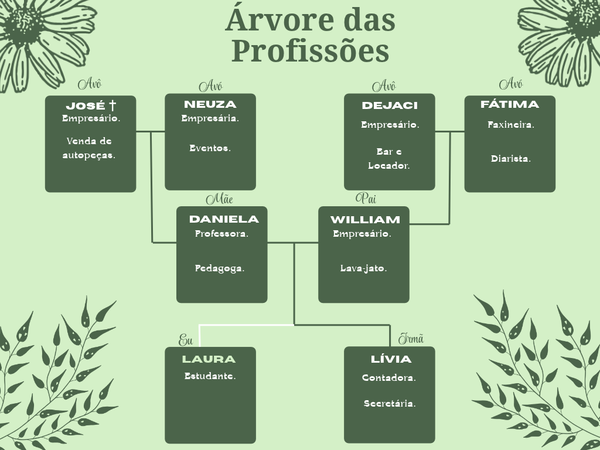

# 🌳 Árvore das Profissões e Impactos da IA

Este repositório reúne o mapeamento das profissões da minha família ao longo de três gerações e uma análise sobre como a tecnologia e a Inteligência Artificial transformaram e ainda vão transformar três dessas áreas de atuação.

---

## 🖼️ Minha Árvore das Profissões

---

## 👨‍👩‍👧‍👧 Trajetórias Profissionais da Família

A construção da árvore evidencia a diversidade de profissões e o espírito empreendedor e trabalhador presentes na minha história:

* **Avô José (†):** Empresário do setor comercial, atuou diretamente na venda de autopeças.
* **Avó Neuza:** Empresária dedicada ao ramo de eventos e gastronomia (buffet).
* **Avô Dejaci:** Comerciante e empresário, atuando com bar e locação de espaços.
* **Avó Fátima:** Trabalhou com serviços gerais, atuando como faxineira e diarista.
* **Mãe Daniela:** Professora e pedagoga, dedicada à educação nos anos iniciais.
* **Pai William:** Empresário, atuando na gestão de lava-jato.
* **Irmã Lívia:** Contadora e secretária, atuando na área financeira e administrativa.
* **Eu (Laura):** Estudante, construindo minha formação acadêmica e profissional a partir das referências da minha família.

---

## 🤖 Pesquisa: O que mudou e o que vai mudar com a IA

Como parte do projeto, pesquisei a evolução histórica (últimos 20 anos) e as tendências futuras com a Inteligência Artificial (próximos 10 anos) em três profissões da minha árvore:

1. **Comerciante de Autopeças:** Migração dos catálogos de papel para sistemas digitais e e-commerce, caminhando para estoques geridos por previsão de demanda e atendimento automatizado por compatibilidade de veículos.
2. **Contadora e Secretária:** Substituição de livros e arquivos físicos por sistemas como SPED e Nota Fiscal Eletrônica, evoluindo para a automação de tarefas repetitivas e um papel cada vez mais estratégico e consultivo.
3. **Empresária de Eventos e Gastronomia (Dona de Buffet):** Expansão da divulgação pelas redes sociais e cardápios personalizados, avançando para orçamentos automatizados e cálculos precisos de insumos para evitar desperdícios.

👉 **[Clique aqui para ler a pesquisa completa com as fontes e links](pesquisa.md)**

---

## 📂 Arquivos do Repositório

* [`arvore.png`](arvore.png): Diagrama visual da árvore das profissões da família criado no Canva.
* [`pesquisa.md`](pesquisa.md): Levantamento detalhado com fontes confirmadas sobre as transformações nas três profissões escolhidas.
* [`README.md`](README.md): Apresentação geral do projeto.
